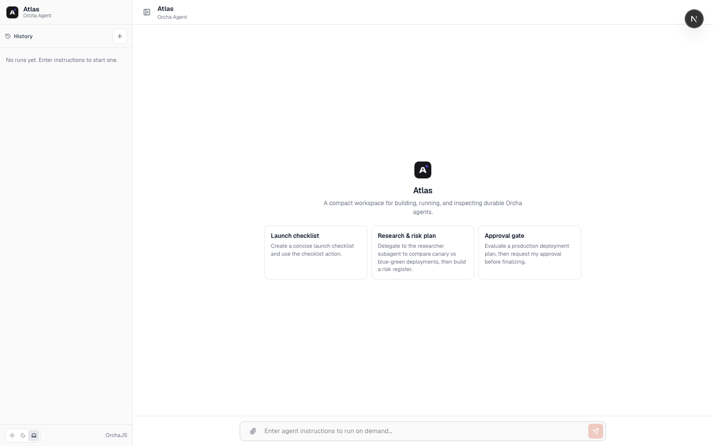

# Orcha Agent UI Template

A full-stack Next.js workspace for building, running, and inspecting durable AI agents and subagents with **[OrchaJS](https://github.com/Amarsia/orcha)** ([`orchajs` on npm](https://www.npmjs.com/package/orchajs)). Use it as a production starter or a hands-on reference for multi-step agent execution, subagent delegation, client-side approvals, and multimodal file input.



## Links

- **OrchaJS GitHub**: [github.com/Amarsia/orcha](https://github.com/Amarsia/orcha)
- **OrchaJS npm package**: [npmjs.com/package/orchajs](https://www.npmjs.com/package/orchajs)

---

## Why This Template

- **No separate backend required** — Everything runs inside this single Next.js app. OrchaJS handles model calls, tool execution, subagent delegation, pause/resume approvals, and durable session history directly inside Next.js Route Handlers—no separate Python/Node agent server, queue, or database setup needed.
- **`npm run dev` and go** — Install dependencies, drop an `AMARSIA_PROJECT_KEY` (or your own provider key) into `.env`, and run `npm run dev` for a complete, working agent workspace in under a minute.
- **Filesystem-convention agents** — Prompts, actions, subagents, skills, and tests live under `orcha/`. Swap providers/models or add new tools without touching the UI or streaming plumbing.
- **Production-ready from day one** — Ships with HttpOnly visitor isolation, local/cloud session persistence, validated JSON Schema actions, and a Dockerfile for self-hosting.

---

## What's Included

- **On-demand agent workspace** — Streaming NDJSON runs, collapsible sidebar, durable per-browser session history, and deep-linked sessions (`/?session=...`).
- **Subagent delegation & inspector** — `Atlas` can delegate research tasks to the `researcher` subagent (`orcha/researcher/`) and lets you drill into the child session's full event timeline with breadcrumb navigation.
- **Interactive client actions** — `request_approval` pauses the durable run (`waiting_for_client_action`), renders an inline approval form in the UI, and resumes the exact paused run once resolved.
- **Built-in local actions** — Validated JSON Schema tools under `orcha/assistant/actions/` (`create_checklist`, `prioritize_tasks`, `build_risk_register`, `calculate_metrics`).
- **Image & document uploads** — Attach images, PDFs, Markdown, CSV, JSON, Word, or Excel files from the composer with inline image thumbnails and visitor-scoped serving (`/api/uploads/[fileId]`).
- **Rich Markdown + compact step trace** — Renders GitHub-flavored Markdown alongside expandable steps for reasoning, tool calls (`Input` / `Output` / duration), skills, evaluations, and subagent runs.
- **Light, Cursor-style dark, and system themes** — Controlled via `next-themes` and `app/globals.css`.

---

## How the Orcha-Powered Design Works

1. **Filesystem-convention agents (`orcha/`)**
   - `orcha/index.ts` initializes OrchaJS with **Amarsia AI Gateway** + cloud session storage when `AMARSIA_PROJECT_KEY` is set, or direct provider keys (`OPENAI_API_KEY`, `ANTHROPIC_API_KEY`, `GOOGLE_API_KEY`, `DEEPSEEK_API_KEY`) as fallback.
   - `orcha/assistant/` defines the primary `Atlas` agent (`index.json`, `instructions.md`, `actions/`, and `tests/`).
   - `orcha/researcher/` defines a private subagent registered under `assistant.subagents`.
2. **Server-side execution (`app/api/executions/route.ts`)**
   - Resolves the private `HttpOnly` visitor identity cookie (`lib/visitor.ts`).
   - Converts uploaded attachment IDs into Orcha file content items (`{ type: "file", filePath, mimeType }`).
   - Calls `assistant.run(...)` for new sessions or `assistant.resume(sessionId, ...)` for follow-up turns, streaming snapshots and canonical events over NDJSON.
3. **Subagent & approval lifecycle (`app/api/sessions/`)**
   - `/api/sessions/[sessionId]/subagents/[childSessionId]` verifies parent lineage via `assistant.subagentEvents(childSessionId)`.
   - `/api/sessions/[sessionId]/tools/[callId]` submits client-action results back into `assistant.resume(sessionId, { toolResults })`.

---

## Quick Start

Requirements: **Node.js 20.9 or newer**.

### 1. Install dependencies & create `.env`

```bash
npm install
cp .env.example .env
```

### 2. Configure credentials

Choose either **Amarsia AI Gateway** (fastest setup — includes free credits, unified routing across providers, and cloud session storage) or **your own model provider keys**:

**Option A — Amarsia AI Gateway (Recommended, includes free credits):**

1. Sign up at [Amarsia](https://amarsia.com).
2. Open **Projects** → **Connect New Project**.
3. Copy the generated project key into `.env`:

```dotenv
AMARSIA_PROJECT_KEY=your_project_key
```

**Option B — Your own model provider keys:**

Leave `AMARSIA_PROJECT_KEY` empty and add the key matching the model configured in `orcha/assistant/index.json` and `orcha/researcher/index.json`:

```dotenv
OPENAI_API_KEY=your_key
# ANTHROPIC_API_KEY=
# GOOGLE_API_KEY=
# DEEPSEEK_API_KEY=
```

### 3. Start the workspace

```bash
npm run dev
```

Open [http://localhost:3000](http://localhost:3000).

> Note: `npm run dev` runs `orchajs build` at startup. Restart `npm run dev` whenever you edit files under `orcha/`.

---

## Standalone Agent Playground & Tests

Test and iterate on the compiled agents directly via Orcha CLI:

```bash
# Open the built-in Orcha Playground UI
npm run agent:playground

# Run declarative tests in orcha/assistant/tests/
npm run agent:test
```

---

## Customization Guide

- **Branding, accent, upload limits, and starter prompts**: `config/app.ts`
- **Primary agent model & behavior**: `orcha/assistant/index.json` and `orcha/assistant/instructions.md`
- **Subagent model & behavior**: `orcha/researcher/index.json` and `orcha/researcher/instructions.md`
- **Local & client actions**: `orcha/assistant/actions/*` (add a folder with `index.json` and `index.js` for OrchaJS to auto-discover it)
- **Workspace UI & custom client-action cards**: `components/agent-workspace.tsx`
- **Theme tokens & styles**: `app/globals.css`

---

## API Endpoints

| Route | Method | Description |
| --- | --- | --- |
| `/api/executions` | `POST` | Starts or resumes an agent run and streams NDJSON snapshots. |
| `/api/uploads` | `POST` | Validates and stores a visitor-scoped attachment under `.orcha/uploads/<visitorId>/`. |
| `/api/uploads/[fileId]` | `GET` | Serves a visitor-owned attachment for image previews and downloads. |
| `/api/sessions` | `GET` | Lists durable sessions owned by the current browser visitor. |
| `/api/sessions/[sessionId]` | `GET` | Loads projected session details, history, and canonical events. |
| `/api/sessions/[sessionId]/history` | `GET` | Loads paginated projected history. |
| `/api/sessions/[sessionId]/events` | `GET` | Loads stable paginated canonical events. |
| `/api/sessions/[sessionId]/subagents/[childSessionId]` | `GET` | Loads canonical events for a child session owned by `sessionId`. |
| `/api/sessions/[sessionId]/tools/[callId]` | `POST` | Submits a pending client-action result and streams the resumed run. |

---

## Project Structure

```text
app/
  api/                  Execution stream, sessions, subagents, client-action tools, and uploads
  globals.css           Light/dark theme tokens, timeline, subagent breadcrumb, and media styles
  layout.tsx            Fonts, metadata, and theme provider
components/
  agent-workspace.tsx   Sidebar, timeline, subagent inspector, approval card, and composer
  rich-markdown.tsx     GitHub-flavored Markdown renderer
  theme-provider.tsx    next-themes wrapper
  theme-selector.tsx    Light / dark / system switcher
config/
  app.ts                Branding, accent color, upload limits, and starter prompts
lib/
  orcha-server.ts       Server-only Orcha runtime accessor
  types.ts              Shared session, timeline, and streaming types
  uploads.ts            Visitor-scoped file storage helpers
  visitor.ts            HttpOnly visitor identity cookie helper
orcha/
  index.ts              Orcha registry (Amarsia AI Gateway / direct providers + subagents)
  assistant/            Atlas agent (instructions, actions, tests)
  researcher/           Private subagent delegated by Atlas
```

---

## License

MIT
